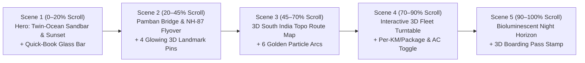

# 🎬 Dhanushkodi Tours & Travels: 5-Scene 3D Scrollytelling Storyboard & Motion Narrative
*Engineered by the Visual Storyteller Agent (`agency-visual-storyteller`)*

---

## 🧠 1. Visual Storyteller Strategy & Narrative Arc

* **Brand Identity**: **Dhanushkodi Tours & Travels** — Premier 3D interactive coastal & South India expedition platform.
* **Protagonist**: The Traveler (families, heritage seekers, pilgrims, and luxury coastal explorers) seeking a transparent, awe-inspiring journey from Pamban Island across South India.
* **Conflict**: Traditional travel agency websites bury iconic destinations like Arichal Munai and the Pamban Sea Bridge under cluttered text tables, hidden per-km charges, and uninspiring vehicle lists.
* **Resolution**: A seamless 5-scene 3D WebGL scrollytelling journey that flies the user from the twin-ocean sunset of **Dhanushkodi (`0%`)**, over the **Pamban Sea Bridge (`20%–45%`)**, across a **3D Topographical South India Route Network (`45%–70%`)**, into an **Interactive 3D Fleet Showcase (`70%–90%`)**, and concludes with a **3D Boarding Pass Checkout (`90%–100%`)** that stamps **`"READY TO DEPART"`**.

---

## 🎞️ 2. Master 5-Scene Storyboard & Motion Specifications

### Scene 1 (`0% – 20% Scroll` — Hero): Twin-Ocean Confluence & Golden Sunset
* **Narrative Role**: **Beginning (Hook & Instant Action)** — Establishes the mythic geography of Arichal Munai where two oceans collide under a golden sunset sky.
* **3D WebGL Environment**:
  * Curved coastal globe horizon & tapering **Dhanushkodi Sandbar (`Arichal Munai`)** flanked by two distinct animated GLSL/vertex wave shaders:
    * **North / Left**: Turquoise **Bay of Bengal** (`#0FB9B1`) with brisk, shimmering crests.
    * **South / Right**: Deep Sapphire **Indian Ocean / Gulf of Mannar** (`#0A2463`) with deep, slow swells.
  * Volumetric **Golden Sunset Orb** (`#F59E0B` -> `#EA580C`) casting a warm specular reflection path down the sandbar tip.
* **Camera Choreography**:
  * **Virtual Lens**: `35mm` wide cinematic prime (`FOV: 45°`), sweeping from high orbital horizon (`X: 0, Y: 14, Z: 38`) down toward the tip of the sandbar (`X: 0, Y: 8, Z: 24`).
* **UI & Motion Choreography**:
  * **Staggered Hero Title**: 3-tier staggered kinetic reveal (`cubic-bezier(0.16, 1, 0.3, 1)`).
  * **Floating Glassmorphic Quick-Book Bar**: Instant selector for Pickup, Destination Circuit, Date, and Fleet Class that synchronizes directly with the Scene 5 Boarding Pass.

---

### Scene 2 (`20% – 45% Scroll` — Pamban & Coastal Flyover): Bridge & Highway Telemetry
* **Narrative Role**: **Rising Action (Spatial Discovery)** — Guides the traveler across India's most iconic sea causeway and coastal corridor.
* **3D WebGL Environment**:
  * 3D structural representation of the **Pamban Sea Bridge** (concrete piers, central vertical-lift/Scherzer span, rail & road deck) transitioning into the **Dhanushkodi Coastal Highway (`NH-87`)** bisecting the sea.
  * **4 Glowing 3D Landmark Pins** pulsing in world-space with real-time 3D-to-2D screen projection:
    1. **Pamban Sea Bridge** (`2.06 km engineering marvel & vertical lift span`)
    2. **Ramanathaswamy Temple** (`1,219-pillar sacred corridor & 22 Theerthams`)
    3. **Ghost Town Ruins** (`1964 cyclone-preserved coral limestone church & station`)
    4. **Arichal Munai** (`Final land tip overlooking Ram Setu shoals`)
* **Camera Choreography**:
  * **Virtual Lens**: `24mm` ultra-wide (`FOV: 58°`) with a `-3.8°` banking roll as the camera tracks along the bridge spline (`X: -14 -> +10, Y: 6.5, Z: 16 -> 4`).
* **UI & Motion Choreography**:
  * Floating **HUD Info Cards** synchronized to the active 3D pin, displaying GPS coordinates, optimal visit hour, halt duration, and a one-click `"Lock Landmark into Itinerary"` action.

---

### Scene 3 (`45% – 70% Scroll` — Interactive South India Route Network): 3D Topographical Map
* **Narrative Role**: **Expansion (Regional Mastery)** — Connects the coastal peninsula to South India's crown-jewel hill stations and temple cities.
* **3D WebGL Environment**:
  * Elevated **3D Topographical Relief Map of South India** featuring stylized Western Ghats & Eastern Ghats elevation ridges.
  * **6 Glowing Golden Particle Arcs (`CatmullRomCurve3`)** launching from **Rameswaram / Dhanushkodi** to:
    1. **Madurai** (`175 km · 3.5 hrs` — Meenakshi Amman Temple Hub)
    2. **Kanyakumari** (`310 km · 5.5 hrs` — Three-Ocean Triveni Sangamam)
    3. **Kodaikanal** (`290 km · 6.0 hrs` — Misty Shola Peaks & Lake)
    4. **Munnar** (`335 km · 7.0 hrs` — High-Range Tea Estates)
    5. **Ooty** (`455 km · 8.5 hrs` — Nilgiri Mountain Sanctuary)
    6. **Tirupati** (`610 km · 10.5 hrs` — Sacred Tirumala Hills)
* **Camera Choreography**:
  * **Virtual Lens**: `40mm` cartographic orbital angle (`X: 0, Y: 24, Z: 22`) tilting down at `-48°` to display all golden trajectories clearly.
* **UI & Motion Choreography**:
  * Clicking any of the 6 route cards highlights its 3D golden arc, accelerates particle flow along that spline, and updates live **Distance, Highway Corridor, Toll Estimate, and Recommended Multi-Day Package**.

---

### Scene 4 (`70% – 90% Scroll` — Cab & Tour Fleet Showcase): Interactive 3D Turntable
* **Narrative Role**: **Climax (Transparent Comfort & Decision Clarity)** — Eliminates pricing ambiguity with an interactive 3D vehicle configurator.
* **3D WebGL Environment**:
  * Illuminated **3D Coastal Turntable Stage** featuring an articulated 3D vehicle assembly that dynamically reconfigures geometry, proportions, roof-rack, wheel-base, and livery across 4 fleet classes:
    1. **Innova Crysta SUV** (`6+1 / 7+1 Captain Seats` · `₹18/km` AC | `₹4,500` Dhanushkodi Day Tour)
    2. **Luxury Tempo Traveller** (`12 / 17 Seater Maharaja Pushback` · `₹26/km` AC | `₹7,200` Day Tour)
    3. **Comfort Sedan (Etios / Dzire)** (`4+1 Seater` · `₹13/km` AC | `₹3,200` Day Tour)
    4. **Luxury AC Coach** (`35 / 45 Seater Air Suspension` · `₹48/km` AC | `₹14,500` Day Tour)
  * **Interactive AC Particle System**: Toggling **AC ON/OFF** activates/deactivates glowing cyan climate-control airflow particles around the 3D cabin and updates live tariffs.
* **Camera Choreography**:
  * **Virtual Lens**: `50mm` studio showcase lens (`FOV: 38°`) at low showroom angle (`Y: 3.8, Z: 14`), with user-controlled 360° turntable rotation.

---

### Scene 5 (`90% – 100% Scroll` — Interactive Boarding Pass Checkout): Bioluminescent Horizon
* **Narrative Role**: **Resolution (Tactile Confirmation)** — Turns checkout into a memorable keepsake moment.
* **3D WebGL Environment**:
  * Night sky with 1,500 twinkling stars over a **Bioluminescent Ocean Horizon** (`#00F5D4` & `#38BDF8` glowing wave crests washing along the sandbar).
* **UI & Motion Choreography**:
  * **Interactive 3D Tilt Boarding Pass**: Perforated gold-and-obsidian boarding ticket showing live route code (`RMD/DHK -> DEST`), selected vehicle, AC status, itemized transparent fare, and passenger manifest.
  * **"READY TO DEPART" Stamp Animation**: Submitting the form triggers a high-impact physical stamp animation (`scale(2.8) -> scale(1)` with elastic bounce + bioluminescent 3D ocean shockwave) stamping **`READY TO DEPART`** across the boarding pass.

---

## ♿ 3. Accessibility (WCAG 2.2 AA) & Performance Architecture
* **Reduced Motion (`prefers-reduced-motion: reduce` + Header Toggle)**: Switches from continuous spline banking to calm, zero-roll static camera keyframes per scene.
* **Keyboard & Screen Reader Parity**: All 3D pins (Scene 2), route arcs (Scene 3), and fleet models (Scene 4) are fully operable via keyboard `Tab`/`Enter` with live ARIA announcements.
